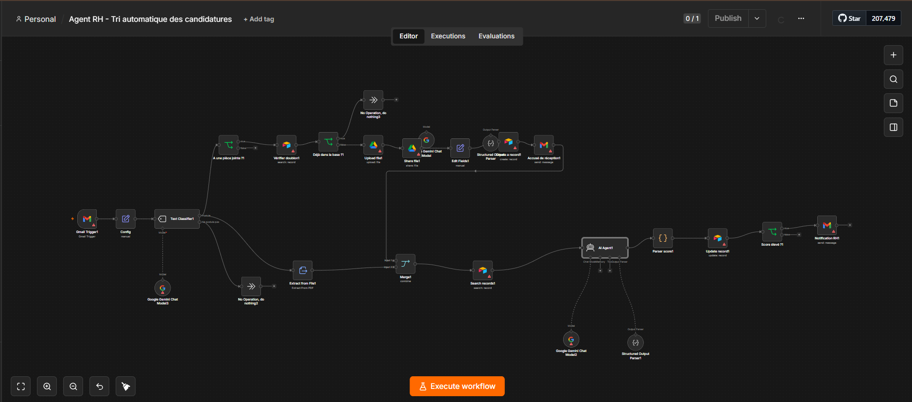
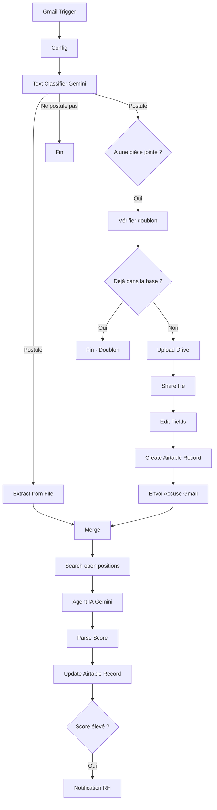

# Agent RH - Tri automatique des candidatures

Ce workflow automatise le traitement des candidatures entrantes par email, avec analyse IA via Gemini, gestion des CV dans Google Drive et suivi du pipeline dans Airtable.

Veuillez consulter [CONTRIBUTING.md](CONTRIBUTING.md) pour les règles de contribution.

## Fonctionnalités

- Réception automatique des emails de candidature.
- Tri initial (IA) pour différencier les candidatures des autres messages.
- Extraction du CV, sauvegarde sur Google Drive, et partage de lien.
- Analyse intelligente du profil (Agent Gemini) face à l'offre d'emploi.
- Scoring automatique de 0 à 10 et extraction des compétences.
- Enregistrement complet dans Airtable.
- Envoi automatisé d'un accusé de réception au candidat.
- Notification ciblée à l'équipe RH si le candidat obtient un score >= 7/10.

## Architecture

## Stack Technique

| Service | Usage |
|---|---|
| **n8n** | Orchestrateur central |
| **Gmail** | Trigger entrant, envoi des notifications et accusés |
| **Google Drive** | Stockage et hébergement des PDF (CVs) |
| **Google Gemini (Langchain)** | Classification textuelle et Agent RH d'analyse structurée |
| **Airtable** | Base de données de suivi (Candidats et Offres) |

## Démarrage Rapide

1. Clonez ce dépôt.
2. Configurez vos variables d'environnement en vous basant sur `.env.example`.
3. Créez vos tables Airtable en suivant le format défini dans le dossier `data/`.
4. Importez le fichier `workflow.json` dans votre instance n8n.
5. Connectez vos credentials (Gmail, Drive, Gemini, Airtable).
6. Remplacez les valeurs "YOUR_..." par vos véritables IDs dans les nœuds Airtable et Drive.
7. Testez et activez le workflow !

Lisez notre [Documentation d'installation complète](docs/installation.md).

## Sécurité & Avertissements

- **Consentement RGPD** : Assurez-vous d'avoir le droit de traiter ces données personnelles via une IA tierce.
- Reportez-vous à [SECURITY.md](SECURITY.md) si vous trouvez la moindre faille ou fuite de donnée.

---
Auteur : Nombré Alidou Salim
Licence : MIT
